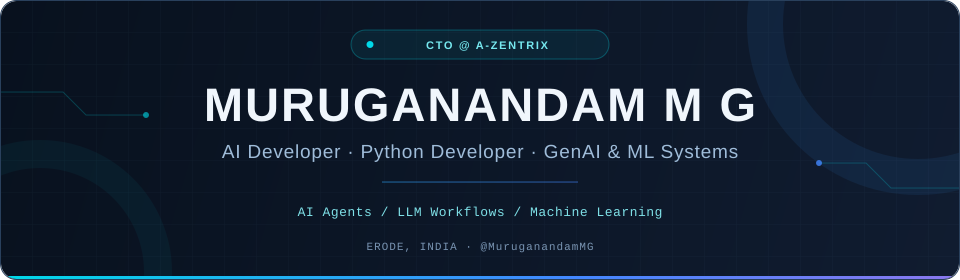

 

  

---

## 🧭 About Me

I'm **Muruganandam M G**, an **AI Developer, Python Developer, and CTO at A-Zentrix**, based in **Erode, Tamil Nadu, India**. I'm pursuing a **B.Tech in Artificial Intelligence & Data Science** at **Nandha Engineering College (Autonomous)**, with graduation expected in **2028**.

I build **Python, FastAPI, and React applications** across Git-native coding automation, LangChain-powered productivity tools, healthcare ML prototypes, and computer vision. My focus is on implementation: **API design, model evaluation, testing, debugging, and maintainable code**.

| Area | What I work on |
| :--- | :--- |
| 🧭 **Technical Leadership** | CTO at **A-Zentrix**; Team Lead for **TuneEng (2025–2026)**. |
| 🤖 **Agents & GenAI** | Git-native coding agents, LLM integrations, RAG, vector search, and tool orchestration. |
| 🫀 **ML & Computer Vision** | Coronary-risk prediction prototypes, explainability, model evaluation, and face analysis. |
| ⚡ **Application Development** | Python APIs, React/TypeScript interfaces, databases, and automated validation. |

---

## 💼 Experience

### Chief Technology Officer · A-Zentrix

**Current role**

- Work on technical direction and application architecture, connecting AI components, backend services, and web interfaces.
- Contribute to the company's React/TypeScript web application and coordinate development through Git and GitHub.

### Team Lead · TuneEng

**2025–2026**

- Led the team developing an AI-assisted English communication platform with speaking practice, language feedback, and interview-preparation features.
- Coordinated development tasks and integration across frontend, backend, and AI-driven learning features.

### AI & Full-Stack Project Developer · Student Projects

**2023–Present**

- Build AI prototypes and supporting applications with Python, FastAPI, and React, working across model integration, API design, debugging, and evaluation.

---

## 🚀 Featured Projects

<table>
<tr>
<td width="50%" valign="top">

### 🤖 Agent Forge

**Git-native coding automation.**

A terminal-based coding assistant that plans, edits, and validates changes inside a Git repository.

- Gathers working-tree context and breaks requests into executable tasks.
- Uses Git-oriented patch handling and sandboxed evaluation.
- Connects LLM-assisted changes with pytest validation and iterative repair.

**[Explore Agent Forge →](https://github.com/MuruganandamMG/agent-forge)**

</td>
<td width="50%" valign="top">

### 🧠 Aura AI

**An AI companion for habits and focused work.**

A personal growth and productivity application with LangChain workflows and Gemini and OpenAI integrations.

- FastAPI endpoints and LangChain prompt workflows for conversational mentoring.
- Authenticated routines, progress check-ins, and focus sessions with async SQLAlchemy and SQLite.
- Habit analytics, AI guidance, calendar/CSV exports, and automated tests.

**[Explore Aura AI →](https://github.com/MuruganandamMG/AI-LLM-integration-using-LangChain-prompt-workflows)**

</td>
</tr>
<tr>
<td width="50%" valign="top">

### 🫀 CardioVision AI

**IIT Mandi Hackathon · Healthcare ML prototype.**

A coronary-risk decision-support prototype connecting ML predictions with interactive 3D anatomical visualization.

- Multi-target ML on the UCI Z-Alizadeh Sani dataset for CAD and vessel-specific stenosis risk.
- Three.js heart visualization for inspecting coronary regions and predicted risk levels.
- SHAP explanations, ROC/precision-recall curves, threshold analysis, and evidence reports.

**[Explore the hackathon project →](https://github.com/asmohamedarfeen/IIT-Mandi-Hackathon-)**

</td>
<td width="50%" valign="top">

### 👁️ Neural Age & Gender Engine

**Computer vision with a browser interface.**

A Flask-powered image analysis prototype with face localization and age/gender-estimation outputs.

- Image uploads, OpenCV processing, and structured results.
- Face bounding-box overlays and confidence displays.
- A responsive interface with adjustable inference delay for workflow testing.

**[Explore the vision project →](https://github.com/MuruganandamMG/age-and-gender-detection-using-a-custom-Deep-Learning)**

</td>
</tr>
</table>

<a href="https://github.com/MuruganandamMG?tab=repositories"><b>See all my repositories →</b></a>

---

## 🛠️ Technologies I Work With

| Layer | Tools & technologies |
| :--- | :--- |
| **Programming** | Python · JavaScript · TypeScript · SQL |
| **AI & GenAI** | Machine Learning · Deep Learning · LLMs · RAG · AI Agents · NLP · Computer Vision · Prompt Engineering |
| **Frameworks & Libraries** | FastAPI · Flask · LangChain · LangGraph · scikit-learn · CatBoost · XGBoost · LightGBM · OpenCV · SHAP |
| **Web & Databases** | React · HTML · CSS · Tailwind CSS · PostgreSQL · MySQL · SQLite · ChromaDB · SQLAlchemy · Three.js |
| **Tools & DevOps** | Git · GitHub · Docker · Ollama · VS Code · Cursor · pytest · Kubernetes (basic) |
| **Core Concepts** | REST APIs · Backend Development · Model Evaluation · Vector Search · Tool Orchestration · Debugging |

---

## 🎓 Education & Professional Membership

**B.Tech · Artificial Intelligence & Data Science** 
**Nandha Engineering College (Autonomous)** · Perundurai, Erode, Tamil Nadu 
2024–2028 · Expected graduation: **2028**

**IEEE · Member**

## 📜 Certifications

- **LinkedIn Learning** — Advanced Prompt Engineering Techniques
- **Great Learning** — Introduction to Neural Networks & Deep Learning
- **SWAYAM (Skill India)** — Cloud Computing
- **IBM Cognitive Class** — Machine Learning with Python

---

## 📊 GitHub Activity

  

---

### Build. Learn. Make it useful.

I'm interested in **AI agents, GenAI applications, healthcare ML, and practical software systems**.

**[LinkedIn](https://www.linkedin.com/in/muruga007/) · [Email](mailto:muruga004kvp@gmail.com) · [Explore my work](https://github.com/MuruganandamMG?tab=repositories)**

 

